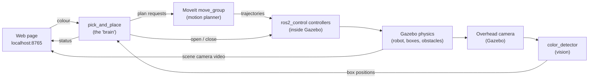
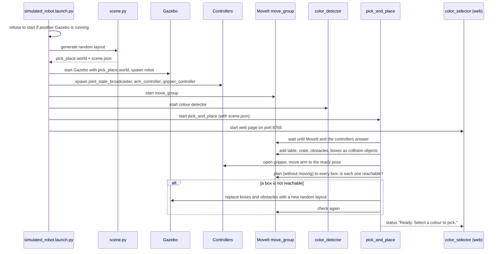
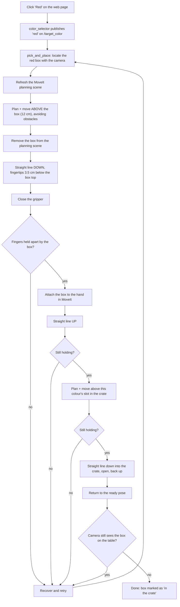
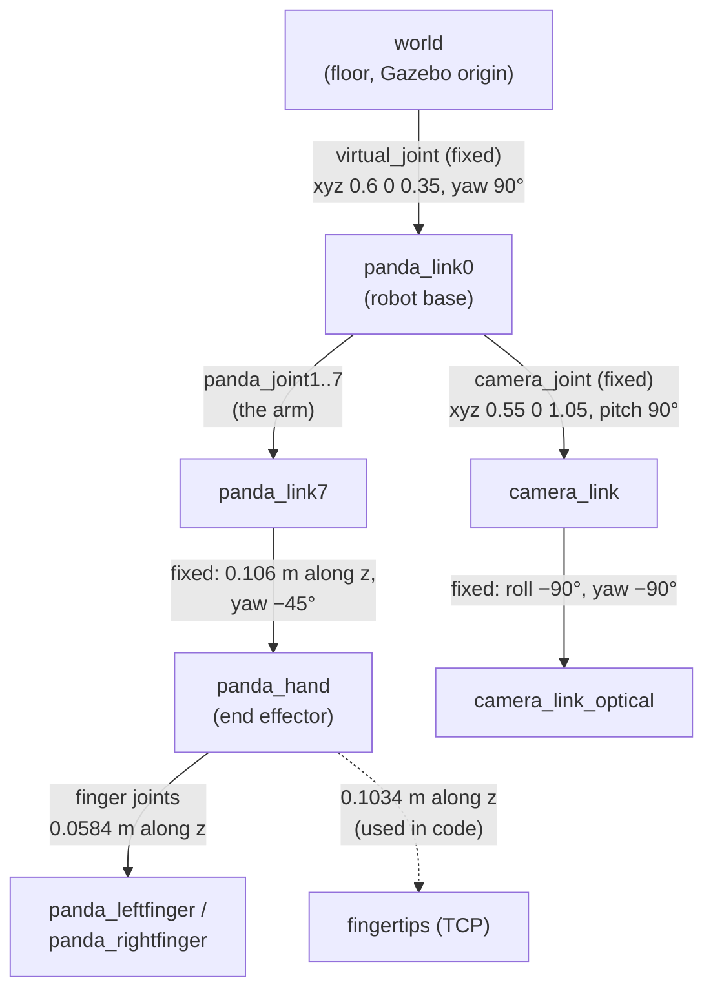

# Franka Panda colour pick & place: complete guide

This guide explains the whole project from zero: what to install, how to run it,
what every file is for, what happens behind the scenes when you click a button,
how the camera finds the coloured boxes, and how positions are converted between
the camera, the table, the robot base and the gripper.

It is written for someone who is new to robotics and ROS 2. Terms are explained
the first time they appear.

---

## Contents

1. [What the project does](#1-what-the-project-does)
2. [Quick start](#2-quick-start)
3. [What needs to be installed, and why](#3-what-needs-to-be-installed-and-why)
4. [Robotics concepts used in this project](#4-robotics-concepts-used-in-this-project)
5. [The workspace, file by file](#5-the-workspace-file-by-file)
6. [What happens when you launch](#6-what-happens-when-you-launch)
7. [What happens when you click a colour](#7-what-happens-when-you-click-a-colour)
8. [How the colour detection works](#8-how-the-colour-detection-works)
9. [Coordinate frames and transformations](#9-coordinate-frames-and-transformations)
10. [Random layouts and the reachability check](#10-random-layouts-and-the-reachability-check)
11. [Checks and automatic retries](#11-checks-and-automatic-retries)
12. [Topics, services and actions](#12-topics-services-and-actions)
13. [Settings you can change](#13-settings-you-can-change)
14. [Troubleshooting](#14-troubleshooting)

---

## 1. What the project does

A simulated **Franka Emika Panda** robot arm (7 joints plus a two-finger gripper)
stands on a table. On the table are:

* three small boxes: **red**, **green** and **blue** (5 × 5 × 8 cm),
* several grey **obstacles** (walls, pillars, blocks, towers, slabs; 6 by default),
* a **yellow crate with a black rim**, the place where the boxes have to go.

You open a web page, click a colour, and the robot:

1. finds the box of that colour with an overhead camera,
2. plans a path for the arm that does not hit any obstacle,
3. moves above the box, goes straight down, closes the gripper,
4. lifts the box, carries it to the crate (again avoiding obstacles),
5. lowers it into its own slot in the crate and lets go,
6. checks that it really worked, and tries again if it did not.

Every launch, and every click on **New random layout**, puts the boxes and
obstacles in new random places.

Everything runs inside a Docker container. You do not need a robot or a graphics
display: the web page shows a live video of the simulation.



---

## 2. Quick start

### 2.1 Open the project in the container

1. Install **Docker Desktop** and **VS Code** with the **Dev Containers** extension.
2. Open this folder in VS Code and choose **Reopen in Container**. The first time,
   VS Code builds the image from `.devcontainer/Dockerfile` (this takes a while).

### 2.2 Build

In a terminal inside the container, from the workspace folder
(`/workspaces/franka-panda-robot`):

```bash
colcon build --symlink-install
source install/setup.bash
```

* `colcon build` compiles/installs all packages in `src/` into `install/`.
* `--symlink-install` links the Python files instead of copying them, so after
  changing a `.py` file you only need to restart the launch, not rebuild.
* `source install/setup.bash` tells the terminal where the built packages are.
  Do this in **every new terminal**.

### 2.3 Run

```bash
ros2 launch panda_bringup simulated_robot.launch.py
```

Wait until the terminal prints `[idle] Ready. Select a colour to pick.` (about
20–40 seconds), then open **http://localhost:8765** in your browser. VS Code
forwards the port from the container to your computer.

On the page you see:

| Part of the page | What it shows |
| --- | --- |
| **Gazebo simulation (live)** | Video from a camera in the simulated room. You watch the arm move here |
| **Pick a colour** | One button per box. Buttons of boxes already in the crate are disabled |
| **New random layout** | Moves the boxes and obstacles to new random places (boxes in the crate go back on the table) |
| **Robot status** | What the robot is doing right now, and which boxes are in the crate |
| **Overhead camera (detections)** | The image the robot uses to find the boxes, with the detections drawn on it |

Stop everything with **Ctrl+C** in the launch terminal. Only one simulation can
run at a time; the launch refuses to start if another one is still running.

You can also send commands from a second terminal (after `source install/setup.bash`):

```bash
ros2 topic pub --once /target_color std_msgs/msg/String "{data: red}"
ros2 topic pub --once /pick_place/new_layout std_msgs/msg/String "{data: ''}"
ros2 topic echo /pick_place/status
```

### 2.4 Launch options

Add them to the launch command, for example
`ros2 launch panda_bringup simulated_robot.launch.py num_obstacles:=8 seed:=42`.

| Option | Default | Meaning |
| --- | --- | --- |
| `seed` | empty | Random seed for the layout. Empty: new layout every launch. A number: the same layout every time (useful to reproduce a problem) |
| `num_obstacles` | `6` | How many obstacles are placed on the table |
| `target_color` | empty | Start picking this colour (`red`, `green` or `blue`) as soon as the robot is ready |
| `headless` | `true` without a display | Run Gazebo without its own window |
| `rviz` | `false` when headless | Start RViz (needs a display) |
| `ui_port` | `8765` | Port of the web page |

---

## 3. What needs to be installed, and why

The container image is defined in `.devcontainer/Dockerfile`. It starts from the
official `ros:jazzy-ros-base` image (Ubuntu 24.04 with ROS 2 **Jazzy**) and
installs:

| Package (apt) | Why it is needed |
| --- | --- |
| `build-essential`, `git` | Compilers and git, needed to build packages |
| `python3-colcon-common-extensions` | `colcon`, the tool that builds a ROS 2 workspace |
| `python3-rosdep`, `ros-dev-tools` | Tools to install the dependencies listed in `package.xml` files |
| `ros-jazzy-moveit` | **MoveIt 2**, the motion planner that computes collision-free arm movements |
| `ros-jazzy-ros-gz` | **Gazebo Harmonic** simulator plus the bridges between Gazebo and ROS 2 |
| `ros-jazzy-gz-ros2-control` | Plugin that lets ROS 2 controllers drive the simulated joints in Gazebo |
| `ros-jazzy-ros2-control`, `ros-jazzy-ros2-controllers` | The controller framework and the standard controllers (joint trajectory controller, joint state broadcaster) |
| `ros-jazzy-xacro` | Turns the `.xacro` robot description files into plain URDF |
| `ros-jazzy-robot-state-publisher` | Publishes the position of every robot link (TF) from the joint angles |
| `ros-jazzy-joint-state-publisher-gui` | Slider window to move the joints by hand (optional tool) |
| `ros-jazzy-rviz2` | 3D visualisation tool (optional, needs a display) |
| `ros-jazzy-cv-bridge` | Converts ROS image messages to OpenCV images and back |
| `ros-jazzy-tf2-ros-py` | Python library to look up coordinate transforms (TF) |
| `python3-opencv`, `python3-numpy` | Image processing and maths for the colour detection |

One dependency is not installed with apt: **pymoveit2** (version 4.0.0, by
Andrej Orsula, <https://github.com/AndrejOrsula/pymoveit2>). Its source is in
`src/pymoveit2` and is built together with the project. It is a Python library
that makes it easy to talk to MoveIt from Python.

If you use your own ROS 2 Jazzy installation instead of the container:

```bash
sudo apt-get update
rosdep install --from-paths src --ignore-src -r -y
colcon build --symlink-install
```

---

## 4. Robotics concepts used in this project

You need these ideas to understand the files. Each is explained in a few lines.

**ROS 2 (Robot Operating System 2).** A framework in which a robot program is
split into many small programs called **nodes** that talk to each other. In this
project, for example, the camera processing and the arm control are separate nodes.

**Topic.** A named channel. One node *publishes* messages on it, any number of
nodes *subscribe* to it. Example: the detector publishes box positions on
`/color_coordinates`; the pick-and-place node subscribes to it.

**Service.** A request/response call: a node asks another node something and
waits for one answer. Example: "plan a path from here to there".

**Action.** Like a service for long tasks: you send a goal, get progress, and
finally a result. Example: "follow this joint trajectory" takes several seconds.

**Launch file.** A Python file that starts many nodes at once with the right
settings. `simulated_robot.launch.py` starts the whole project.

**Package.** A folder with code, a `package.xml` (name and dependencies) and a
build file (`CMakeLists.txt` or `setup.py`). The project consists of 7 packages.

**URDF / xacro.** URDF is an XML description of a robot: its **links** (rigid
parts) and **joints** (how links move relative to each other), plus their shapes,
masses and limits. Xacro adds variables and includes to URDF so it can be split
into several files.

**TF (transforms) and frames.** Every part of the robot and every sensor has its
own **coordinate frame** (an origin and x/y/z axes). TF is the ROS system that
knows where every frame is relative to the others at every moment. See section 9.

**Gazebo.** A physics simulator. It simulates gravity, contacts, friction, the
motors and the cameras, so the code behaves as it would on a real robot.

**ros2_control.** The standard way to command robot joints. A **controller**
receives a desired motion and drives the joints. Here:
* `arm_controller` moves the 7 arm joints along a trajectory,
* `gripper_controller` moves the 2 finger joints,
* `joint_state_broadcaster` publishes the current joint angles on `/joint_states`.

**MoveIt 2.** The motion planning framework. Given a goal ("put the gripper at
this position and orientation"), it computes joint angles (**inverse kinematics**)
and a path (**trajectory**) from the current pose to the goal that avoids
collisions with the objects in its **planning scene**. Its main node is
`move_group`.

**Inverse kinematics (IK).** Forward kinematics answers "with these joint angles,
where is the gripper?". Inverse kinematics answers the opposite: "which joint
angles put the gripper here?". This project uses the KDL IK solver.

**OMPL / RRTConnect.** OMPL is the library of planning algorithms MoveIt uses.
RRTConnect grows two random trees of collision-free arm configurations, one from
the start and one from the goal, until they meet. That gives a path around obstacles.

**Cartesian path.** A movement in which the gripper follows a straight line in
space (for example straight down onto a box), instead of whatever path the
planner finds.

**HSV colour space.** Another way to write a colour: **H**ue (which colour, as an
angle), **S**aturation (how strong), **V**alue (how bright). It is much easier to
say "red" in HSV than in RGB, because lighting mostly changes V and not H.

---

## 5. The workspace, file by file

```
franka-panda-robot/
├── .devcontainer/          container definition
├── README.md               short overview
├── DOCUMENTATION.md        this guide
└── src/
    ├── panda_description/  what the robot and the world look like
    ├── panda_controller/   how the joints are driven
    ├── panda_moveit/       motion planning configuration
    ├── panda_vision/       finding the boxes in the camera image
    ├── panda_pick_place/   random layout, pick-and-place logic, web page
    ├── panda_bringup/      one launch file that starts everything
    └── pymoveit2/          Python library for MoveIt (third party)
```

`build/`, `install/` and `log/` are created by `colcon build`. You never edit them.

### 5.1 `.devcontainer/`

| File | Purpose |
| --- | --- |
| `Dockerfile` | Recipe for the Linux image: ROS 2 Jazzy plus all packages from section 3 |
| `devcontainer.json` | Tells VS Code how to start the container, and to forward port **8765** (the web page) to your computer |

### 5.2 `panda_description`: the robot and the world

This package only contains descriptions (no running code). Other packages read them.

| File | Purpose |
| --- | --- |
| `urdf/panda.urdf.xacro` | Main robot file. It only includes the five files below |
| `urdf/arm.xacro` | The 8 links and 7 rotating joints of the arm, the hand and two sliding finger joints, with meshes, limits and the position of the robot on the table (`virtual_joint`, see section 9) |
| `urdf/sensors.xacro` | The **overhead camera**: a fixed link above the table, the camera optical frame, and the Gazebo camera sensor (640 × 480 pixels, 10 images/s, field of view 1.0 rad) |
| `urdf/gazebo.xacro` | Gazebo plugins: `gz_ros2_control` (lets ROS controllers move the simulated joints) and the sensors system (renders camera images). Also high friction on the finger pads so boxes do not slip |
| `urdf/ros2control.xacro` | Declares, for every joint, that it is commanded by **position** and reports its position |
| `urdf/materials.xacro` | Colour definitions used in the URDF |
| `meshes/visual/*.dae` | Detailed 3D shapes for drawing the robot |
| `meshes/collision/*.obj` | Simpler 3D shapes used for collision checking (faster) |
| `worlds/table.world` | The base Gazebo world: physics settings, light, four coffee tables forming one long table, and the **scene camera** that films the robot for the web page. It contains a marker comment where the random objects are inserted at launch |
| `worlds/empty.world` | An empty world (used by `gazebo.launch.py` on its own) |
| `models/` | 3D models of the coffee table and a trash bin (from AWS RoboMaker) |
| `launch/gazebo.launch.py` | Starts Gazebo with a world, publishes the robot description (`robot_state_publisher`), spawns the robot into Gazebo, and starts the **bridges** that copy Gazebo data to ROS: the simulation clock, the overhead camera images and info, and the scene camera video |
| `launch/display.launch.py` | Shows the robot in RViz with joint sliders (for exploring the model; needs a display) |
| `rviz/display.rviz` | RViz settings for `display.launch.py` |

### 5.3 `panda_controller`: driving the joints

| File | Purpose |
| --- | --- |
| `config/panda_controllers.yaml` | Defines the controllers: `arm_controller` (7 joints) and `gripper_controller` (2 finger joints), both *joint trajectory controllers* with position commands, plus `joint_state_broadcaster`. Update rate 100 Hz |
| `launch/controller.launch.py` | Starts ("spawns") the three controllers. In simulation the controller manager itself runs inside Gazebo (from the `gz_ros2_control` plugin) |
| `launch/slider_controller.launch.py` + `panda_controller/slider_controller.py` | Optional tool: move the real (simulated) joints with sliders. The node forwards slider values to the two controllers |

### 5.4 `panda_moveit`: motion planning

| File | Purpose |
| --- | --- |
| `config/panda.srdf` | *Semantic* robot description: the planning groups (`arm` = chain from `panda_link0` to `panda_link7`; `gripper` = hand and fingers), named poses (`home`, `open`, `close`), the `virtual_joint` that fixes the robot to the `world` frame, and pairs of links that can never collide (so MoveIt does not waste time checking them) |
| `config/kinematics.yaml` | Which IK solver to use (KDL) and its settings |
| `config/joint_limits.yaml` | Maximum velocity/acceleration per joint used when timing trajectories |
| `config/moveit_controllers.yaml` | Tells MoveIt which controllers execute its trajectories (`arm_controller`, `gripper_controller`) |
| `config/initial_positions.yaml`, `config/pilz_cartesian_limits.yaml`, `config/planning_python_api.yaml` | Standard MoveIt setup files (initial joint values, limits for the Pilz planner, settings for the Python API) |
| `launch/moveit.launch.py` | Starts `move_group`, MoveIt's main node, with all the configuration above, and optionally RViz |
| `rviz/moveit.rviz` | RViz layout with the MoveIt motion planning panel |

### 5.5 `panda_vision`: finding the boxes

| File | Purpose |
| --- | --- |
| `panda_vision/color_detector.py` | The **color_detector** node. Twice per second it takes the latest overhead camera image, finds the red, green and blue boxes, computes each box's position and rotation on the table in the `world` frame, publishes them on `/color_coordinates` as text `R,x,y,z,yaw`, and publishes an annotated image on `/color_detector/debug_image`. Explained in detail in section 8 |
| `setup.py`, `setup.cfg`, `package.xml`, `resource/` | Python package boilerplate: name, dependencies and the `color_detector` command |

### 5.6 `panda_pick_place`: the brain and the web page

| File | Purpose |
| --- | --- |
| `panda_pick_place/scene.py` | **Random layout generator** (no ROS node, a library). It picks random positions for the three boxes and the obstacles following safety rules (section 10), writes the Gazebo world file and `scene.json`, and can replace the layout of a running simulation |
| `panda_pick_place/pick_and_place.py` | The **pick_and_place** node, the brain. It loads the scene into MoveIt's planning scene, checks that every box is reachable, waits for colour requests, plans and executes the pick-and-place motions, checks the result, retries if needed, and publishes its status. Sections 6, 7 and 11 |
| `panda_pick_place/color_selector.py` | The **color_selector** node: a small web server (port 8765) that serves the web page, streams the scene camera as live video, shows the overhead detection image and the status, and turns button clicks into ROS messages |
| `setup.py`, `setup.cfg`, `package.xml`, `resource/` | Python package boilerplate; registers the `pick_and_place` and `color_selector` commands |

### 5.7 `panda_bringup`: start everything

| File | Purpose |
| --- | --- |
| `launch/simulated_robot.launch.py` | The **only command you need**. It checks that no other simulation is running, generates a random layout (`scene.py`), then starts Gazebo, the controllers, MoveIt, the colour detector, the pick-and-place node and the web page |

### 5.8 `pymoveit2`

Third-party Python library (not written for this project). `pick_and_place.py`
uses its `MoveIt2` class to: send planning requests to `move_group`, add and
remove collision objects in the planning scene, and attach a box to the hand.

### 5.9 Files generated at run time

Every launch writes to `/tmp/panda_pick_place/`:

| File | Content |
| --- | --- |
| `pick_place.world` | `table.world` with the boxes, obstacles and crate inserted. Gazebo loads this |
| `scene.json` | The same layout as data: box positions and rotations, obstacle positions/sizes/rotations, crate parts. The pick-and-place node reads it, and rewrites it after **New random layout** |

---

## 6. What happens when you launch



Details:

1. **Safety check.** The launch file looks through the running processes for a
   `gz sim` process. Two simulations would share the same ROS topics and both
   would react to every command, so it stops with a clear message instead.
2. **Random layout.** `scene.py` generates positions (section 10) and writes the
   two files in `/tmp/panda_pick_place/`.
3. **Gazebo** loads the world. The robot description (from xacro) is published by
   `robot_state_publisher` and the robot is spawned at the world origin; the
   URDF's `virtual_joint` puts its base at (0.6, 0, 0.35) on the table.
4. **Bridges** copy Gazebo data into ROS: `/clock` (simulation time),
   `/camera/image_raw` and `/camera/camera_info` (overhead camera),
   `/scene_camera/image` (video for the web page).
5. **Controllers** are spawned inside Gazebo's controller manager.
6. **MoveIt** (`move_group`) starts and listens for planning requests.
7. **pick_and_place** waits for the gripper controller, the joint states and
   MoveIt, then adds the collision objects, opens the gripper, moves the arm to
   the **ready pose** (turned away so it does not block the camera), checks that
   every box can be reached, and reports *Ready*.

---

## 7. What happens when you click a colour



Step by step, with the real numbers (heights are in the `world` frame, metres):

1. **Request.** The web page sends `POST /api/pick {"color": "red"}` to
   `color_selector`, which publishes `red` on `/target_color`. If the robot is
   busy, the request is ignored.
2. **Locate.** `pick_and_place` uses the latest detection of the red box from
   `/color_coordinates` (at most 2 s old, waiting up to 5 s). It gives the box
   centre `(x, y)`, the height of its top face, and its rotation `yaw`. On the
   first attempt only, if the camera does not see the box, it uses the position
   from `scene.json`.
3. **Planning scene.** The table, crate walls, all obstacles and the other boxes
   are (re)sent to MoveIt as boxes to avoid.
4. **Above the box.** The gripper target is directly above the box, pointing
   straight down, rotated to match the box: `yaw`, or `yaw ± 90°`, or
   `yaw + 180°` (a square box can be grasped from any of its four sides). For
   each rotation, OMPL/RRTConnect plans a collision-free path to above the box
   (5 s planning time, 5 parallel attempts), and MoveIt then checks whether the
   straight descent is possible from where that path ends. Some rotations arrive
   with the wrist at its joint limit, from where the hand cannot go straight
   down; those are skipped. The first rotation that passes both checks is
   executed at 25 % of the maximum speed.
   * box top: `0.3657 + 0.08 = 0.4457`
   * hand target (pre-grasp): `0.4457 + 0.1034 − 0.035 + 0.12 = 0.6341`
5. **Descend.** The target box is removed from the planning scene (the fingers
   will touch it on purpose), then a straight-line (Cartesian) move takes the hand
   down 12 cm to `0.5141`, so the fingertips are at `0.4107`, 3.5 cm below the
   box top.
6. **Grasp.** Each finger is commanded to 0.015 m from the centre (closer than
   the 0.025 m half width of the box, so the fingers squeeze it).
7. **Check the grasp.** If the two finger positions add up to less than 40 mm,
   the fingers closed on nothing (empty closed gripper = 30 mm; holding the box
   ≈ 50 mm) and this attempt fails.
8. **Attach.** The box is added back to MoveIt as an object *attached to the
   hand*, so from now on the planner keeps the box itself away from obstacles too.
9. **Lift** straight up to the pre-grasp height and check the fingers again.
10. **Carry.** Plan and move to above this colour's slot in the crate. The crate
    centre is (0.22, −0.14); the slots are 6 cm apart along x: red at x = 0.16,
    green at 0.22, blue at 0.28. The gripper turns so the fingers close along y,
    which leaves room on both sides inside the crate. Check the fingers again.
11. **Place.** Straight down until the box bottom is 2.5 cm above the crate floor,
    open the gripper, remove the box from the planning scene, straight back up.
    Lowering instead of dropping from above prevents boxes from bouncing out.
12. **Return** to the ready pose, where the arm is out of the camera image.
13. **Verify.** The crate is outside the overhead camera's view, so a box in the
    crate is *not* seen. If the camera still sees the red box on the table within
    2 s, the pick failed.
14. **Done.** The status becomes *The red box was dropped into the crate* and the
    red button is disabled.

---

## 8. How the colour detection works

File: `src/panda_vision/panda_vision/color_detector.py`.

### 8.1 The camera

The overhead camera hangs 1.40 m above the floor (about 1.03 m above the table
top), looking straight down at the pick area. It produces 640 × 480 colour images
10 times per second on `/camera/image_raw`, and its **intrinsics** on
`/camera/camera_info`. The intrinsics are four numbers:

* `fx`, `fy`: focal length in pixels. With a horizontal field of view of
  1.0 rad and 640 pixels width: `fx = 320 / tan(0.5) ≈ 585.8`
* `cx`, `cy`: the pixel where the optical axis hits the image, (320, 240)

### 8.2 From image to colour masks

Twice per second the node:

1. converts the image from BGR (OpenCV's channel order) to **HSV**,
2. keeps the pixels whose H, S, V are inside each colour's range
   (OpenCV uses H from 0 to 180):

   | Colour | H | S | V |
   | --- | --- | --- | --- |
   | red | 0–8 **and** 172–180 (red wraps around 0) | 120–255 | 60–255 |
   | green | 45–80 | 120–255 | 60–255 |
   | blue | 105–130 | 120–255 | 60–255 |

   The result is a black-and-white **mask** per colour. The grey obstacles have
   low saturation and the yellow crate has H ≈ 24, so none of them pass.
3. removes single noisy pixels (morphological *opening* with a 3 × 3 kernel),
4. finds the outlines (**contours**) of the white regions and keeps the largest
   one if it has at least 80 pixels.

### 8.3 From a pixel to a point on the table

A pixel does not tell you the distance to the object; it only tells you the
**direction** (a ray from the camera through that pixel). We know the boxes'
top faces are all at the same height, `z = 0.4457`, so the point is where that
ray hits the horizontal plane `z = 0.4457`.

```
pixel (u, v)
   │  1. undo the intrinsics: direction in the camera frame
   ▼
d_cam = ( (u − cx) / fx ,  (v − cy) / fy ,  1 )
   │  2. rotate into the world frame with TF (camera_link_optical → world)
   ▼
d_world = R · d_cam          camera origin o = (0.6, 0.55, 1.40)
   │  3. intersect the ray  p = o + t · d_world  with the plane z = 0.4457
   ▼
t = (0.4457 − o_z) / d_world_z          p = o + t · d_world
```

**Worked example.** For this camera, TF gives a rotation in which image right
(+x of the optical frame) is world +x, image down (+y) is world −y, and the
viewing direction (+z) is world −z (straight down).

* pixel (400, 300): `d_cam = (80/585.8, 60/585.8, 1) = (0.137, 0.102, 1)`
* rotated: `d_world = (0.137, −0.102, −1)`
* `t = (0.4457 − 1.40) / −1 = 0.954`
* `p = (0.6 + 0.954·0.137, 0.55 − 0.954·0.102, 0.4457) ≈ (0.731, 0.452, 0.446)`

### 8.4 Correcting for the side faces

A camera looking down does not only see the top of a box; for a box that is not
directly below the camera it also sees the side faces that point towards the
camera. Those pixels have the same colour, so the colour blob is larger than the
top face and its centre is pulled **towards the point below the camera** (the
*nadir*) by about 1 cm. That is enough for a finger to hit the box.

The detector removes this error with geometry. Projected onto the top-face
plane, the box's bottom edges appear scaled towards the nadir by

```
k = h / (h + box_height) = 0.954 / (0.954 + 0.08) ≈ 0.923
```

where `h` is the camera height above the top faces. Along the direction `e` from
the nadir to the blob:

* the **far** end of the blob belongs to the top face: `far = c + s`
* the **near** end is the scaled bottom face: `near = k · (c − s)`

(`c` = distance of the true centre from the nadir, `s` = half the box extent in
that direction). Solving both equations gives

```
c = (far + near / k) / 2
```

The sideways position is the average of the outline across `e`. This brings the
error down to a few millimetres.

### 8.5 The box rotation (yaw)

The outline is simplified to straight edges (`cv2.approxPolyDP`). Only the edges
on the far half of the blob are used, because those belong to the top face. Each
edge direction is projected onto the table plane and the angles are averaged.
Because a square looks the same after a 90° turn, the angles are multiplied by 4
before averaging and divided by 4 afterwards; the result is between −45° and +45°.

### 8.6 Output

For each colour seen, one message on `/color_coordinates`:

```
R,0.4630,0.3950,0.4457,0.2321
```

colour letter, x, y, z of the top-face centre in the `world` frame (metres), and
yaw (radians). The annotated image on `/color_detector/debug_image` (shown on the
web page) has the outline, the centre and the coordinates drawn on each box.

Measured accuracy against the true positions in Gazebo: 1–6 mm in position and
≤ 2.3° in rotation.

---

## 9. Coordinate frames and transformations

### 9.1 The frames



| Frame | Where it is | Used for |
| --- | --- | --- |
| `world` | On the floor, Gazebo's origin. x along the long table, z up | Everything is expressed here: box positions, obstacles, planning goals |
| `panda_link0` | Centre of the robot's base, on the table at (0.6, 0, 0.35), turned 90° | Root of the arm; MoveIt's arm group starts here |
| `panda_link1` … `panda_link7` | One per arm segment; each moves with its joint | Forward/inverse kinematics |
| `panda_hand` | Wrist flange of the gripper, 0.106 m after `panda_link7` | **End effector**: planning goals are given for this frame |
| fingertips (TCP) | 0.1034 m further along the hand's z axis | Where the object is actually held (Tool Centre Point) |
| `camera_link` | Overhead camera body | Mounting of the camera |
| `camera_link_optical` | Same place, axes in the optical convention: z = viewing direction, x = image right, y = image down | Pixel-to-world conversion (section 8) |

All these transforms are published on `/tf` and `/tf_static` by
`robot_state_publisher` (from the URDF and the current joint angles). The
detector asks TF for `camera_link_optical → world`.

### 9.2 World ↔ robot base

The base frame is the world frame moved by `t = (0.6, 0, 0.35)` and rotated by
`θ = 90°` around z. A point given in the base frame converts to the world frame as

```
p_world = R_z(θ) · p_base + t

R_z(90°) = | 0 −1  0 |        x_w = 0.6 − y_b
           | 1  0  0 |   →    y_w = x_b
           | 0  0  1 |        z_w = 0.35 + z_b
```

and back:

```
x_b = y_w        y_b = 0.6 − x_w        z_b = z_w − 0.35
```

**Example:** a red box centre at world (0.81, 0.44, 0.406) is at
base (0.44, −0.21, 0.056): 44 cm in front of the robot, 21 cm to its right,
5.6 cm above its base plate. In words: the robot looks along world +y, towards
the boxes, and the crate at world (0.22, −0.14) is behind it on its left.

### 9.3 Robot base → camera

`camera_joint` puts the camera at (0.55, 0, 1.05) in the base frame, pitched 90°
so it looks down. With the formulas above that is world
(0.6 − 0, 0.55, 0.35 + 1.05) = **(0.6, 0.55, 1.40)**. The optical frame then has
its z axis pointing straight down (world −z), x along world +x and y along
world −y; this is the rotation `R` used in section 8.3.

### 9.4 Robot base → gripper: the end effector and the TCP

MoveIt plans for the frame `panda_hand`. But the object is held between the
fingertips, 0.1034 m further along the hand's z axis. When the hand points
straight down, its z axis is world −z, so

```
z_hand = z_fingertips + 0.1034
```

To grasp the box 3.5 cm below its top face:

```
z_fingertips = z_top − 0.035 = 0.4457 − 0.035 = 0.4107
z_hand       = 0.4107 + 0.1034                = 0.5141   (grasp pose)
z_hand       = 0.5141 + 0.12                  = 0.6341   (pre-grasp, 12 cm higher)
```

and to release the box in the crate with its bottom 2.5 cm above the crate floor
(floor top at 0.3657 + 0.012 = 0.3777):

```
z_box_bottom = 0.3777 + 0.025 = 0.4027
z_hand = z_box_bottom + box_height − 0.035 + 0.1034 = 0.4027 + 0.1484 = 0.5511
```

### 9.5 Orientation: pointing the gripper straight down

Orientations are given as **quaternions** `(x, y, z, w)`, a compact way to write
a 3D rotation without the problems of angle triples. The grasp orientation is

* first rotate 180° around x (`R_x(π)`): the hand's z axis now points down,
* then rotate by the box yaw around world z (`R_z(yaw)`): the fingers line up
  with the box sides.

Multiplying the two quaternions `R_z(yaw) = (0, 0, sin(yaw/2), cos(yaw/2))` and
`R_x(π) = (1, 0, 0, 0)` gives

```
q = ( cos(yaw/2),  sin(yaw/2),  0,  0 )      # function top_down_quat(yaw)
```

With `yaw = 0` the fingers close along world y. That is the orientation used
above the crate.

### 9.6 Joint space vs Cartesian space

* **Cartesian space**: positions and orientations (x, y, z, quaternion). Goals are
  given here ("hand at (0.46, 0.39, 0.634), pointing down").
* **Joint space**: the 7 joint angles. The controllers work here. MoveIt's IK
  converts goals to joint angles, and the planner produces a list of joint angle
  sets over time (a trajectory).

The **ready pose** is given directly in joint space:
`[90°, −45°, 0°, −135°, 0°, 90°, 45°]`. It turns the arm away from the pick area so
the overhead camera can see all boxes.

---

## 10. Random layouts and the reachability check

### 10.1 The rules for a random layout (`scene.py`)

Everything is placed with random numbers, but with rules that make a solvable
layout very likely:

* **Boxes** are placed in front of the robot, in x 0.20–1.00 and y 0.32–0.78,
  and 0.38–0.68 m from the robot base (close enough to reach, not so close that
  the arm cannot fold over them). Boxes are at least 16 cm apart. Each gets a
  random rotation between −45° and 45°.
* **Obstacles** cycle through five shapes (sizes in metres, x × y × z):
  wall 0.03 × 0.22 × 0.24, pillar 0.06 × 0.06 × 0.36, block 0.14 × 0.08 × 0.14,
  tower 0.09 × 0.09 × 0.30, slab 0.20 × 0.12 × 0.06. Every second obstacle is
  placed **on the way** between the robot and a box (so the planner really has to
  go around it); the others anywhere in a ring 0.30–0.66 m around the robot.
* Each obstacle keeps **10 cm of free space** around every box (room for the
  gripper to come down), 10 cm from other obstacles, and 12 cm from the crate.
* If a rule cannot be met after many tries, the whole layout is drawn again.

`seed` makes the random numbers repeatable: the same seed always gives the same
layout.

### 10.2 The reachability check (`pick_and_place.py`)

Rules are not a guarantee, so after every new layout the robot **tests** it
before reporting *Ready*. For each box it asks MoveIt (planning only, nothing
moves):

1. Is there a collision-free path from the ready pose to the pre-grasp pose above
   the box (for any of the four grasp rotations)?
2. From the end of that path, is a straight descent to the grasp pose possible?

If any box fails, the layout is replaced by a new random one (up to 10 times).

### 10.3 Changing the layout of a running simulation

**New random layout** on the web page publishes on `/pick_place/new_layout`.
The pick-and-place node then:

1. opens the gripper and moves to the ready pose,
2. draws new positions for the three boxes and for the same obstacles,
3. removes the old boxes and obstacles from Gazebo and creates them at the new
   positions (with Gazebo's `remove` and `create_multiple` services; removing and
   re-creating is used because Gazebo does not move the collision shapes of
   static models),
4. saves the new `scene.json`, updates MoveIt's planning scene, clears the old
   detections, and runs the reachability check.

---

## 11. Checks and automatic retries

A simulated grasp can fail just like a real one. Every pick is checked four times:

| When | How | If it fails |
| --- | --- | --- |
| After closing the gripper | Finger opening ≥ 40 mm (box between the fingers) | "The gripper missed the box" |
| After lifting | Same | "The box slipped out of the gripper" |
| Above the crate | Same | "The box was lost on the way to the crate" |
| Back at the ready pose | The camera must **not** see the box on the table any more | "The box is still on the table" |

After a failure the robot **recovers** (opens the gripper, detaches the box in
MoveIt, returns to the ready pose where the camera sees the table) and tries again
with a fresh detection, up to 3 attempts. Only a verified pick marks the box as
*in the crate*.

---

## 12. Topics, services and actions

| Name | Type | From → to | Content |
| --- | --- | --- | --- |
| `/target_color` | topic `std_msgs/String` | web page → pick_and_place | `red`, `green` or `blue` |
| `/pick_place/new_layout` | topic `std_msgs/String` | web page → pick_and_place | Request a new random layout |
| `/pick_place/status` | topic `std_msgs/String` (JSON) | pick_and_place → web page | `state` (starting/idle/busy/done/error), `message`, `picked`, `available` |
| `/color_coordinates` | topic `std_msgs/String` | color_detector → pick_and_place, web page | `R,x,y,z,yaw` |
| `/color_detector/debug_image` | topic `sensor_msgs/Image` | color_detector → web page | Annotated overhead image |
| `/camera/image_raw`, `/camera/camera_info` | topics | Gazebo → color_detector | Overhead camera image and intrinsics |
| `/scene_camera/image` | topic `sensor_msgs/Image` | Gazebo → web page | Video of the robot |
| `/joint_states` | topic `sensor_msgs/JointState` | joint_state_broadcaster → all | Current joint angles (including the fingers) |
| `/tf`, `/tf_static` | topics | robot_state_publisher → all | Coordinate frames |
| `/clock` | topic | Gazebo → all | Simulation time |
| `/plan_kinematic_path` | service | pick_and_place → move_group | Plan a collision-free path (OMPL) |
| `/compute_cartesian_path` | service | pick_and_place → move_group | Plan a straight-line path |
| `/execute_trajectory` | action | pick_and_place → move_group | Execute a planned trajectory |
| `/arm_controller/follow_joint_trajectory` | action | move_group → arm controller | Move the 7 arm joints |
| `/gripper_controller/follow_joint_trajectory` | action | pick_and_place → gripper controller | Move the fingers |
| `/collision_object`, `/attached_collision_object` | topics | pick_and_place → move_group | Planning scene objects |
| `/world/pick_place_world/remove`, `.../create_multiple` | Gazebo services | pick_and_place → Gazebo | Replace models for a new layout |

Web page endpoints (`color_selector`): `GET /` (page), `GET /api/status`,
`GET /camera.jpg` (overhead image), `GET /scene.mjpg` (live video),
`POST /api/pick`, `POST /api/new_layout`.

---

## 13. Settings you can change

Node parameters can be changed in `simulated_robot.launch.py` (in the
`parameters=[...]` of the node) or on the command line.

**pick_and_place**

| Parameter | Default | Meaning |
| --- | --- | --- |
| `max_velocity`, `max_acceleration` | 0.25 | Fraction of the maximum joint speed/acceleration |
| `tcp_offset` | 0.1034 | Distance from `panda_hand` to the fingertips (m) |
| `grasp_depth` | 0.035 | How far below the box top the fingertips go (m) |
| `pregrasp_height` | 0.12 | Height of the approach above the grasp pose (m) |
| `grasp_finger_position` | 0.015 | Commanded finger position when grasping (m per finger) |
| `holding_min_finger_sum` | 0.04 | Finger opening above which the box counts as held (m) |
| `max_attempts` | 3 | Tries per requested colour |
| `max_layout_attempts` | 10 | New layouts tried when a layout is not reachable |
| `detection_timeout` | 5.0 | How long to wait for a camera detection (s) |

**color_detector**

| Parameter | Default | Meaning |
| --- | --- | --- |
| `target_plane_z` | 0.4457 | Height of the box top faces (m) |
| `box_height` | 0.08 | Box height, for the side-face correction (m) |
| `min_area_px` | 80 | Smallest blob that counts as a box (pixels) |
| `publish_rate` | 2.0 | Detections per second |

**Layout** (constants at the top of `scene.py`): box area and distances
(`PICK_X_RANGE`, `PICK_Y_RANGE`, `PICK_RADIUS_RANGE`), obstacle shapes
(`OBSTACLE_TYPES`), clearances (`BOX_OBSTACLE_CLEARANCE`,
`OBSTACLE_MIN_SEPARATION`, `CRATE_CLEARANCE`), crate position and size (`CRATE`).

---

## 14. Troubleshooting

| Symptom | Cause and fix |
| --- | --- |
| `localhost:8765` shows another website or nothing | Check VS Code's **Ports** tab: port 8765 must be forwarded. If something else on your computer uses 8765, start with `ui_port:=8770` and open that port |
| Launch stops with *Another Gazebo simulation is already running* | An earlier launch is still running. Press Ctrl+C in its terminal, or run `pkill -f 'gz sim'` |
| The page says *Simulation not running* | The launch is not running (or is still starting). Start it and wait for *Ready* |
| Video says *OFFLINE* but the status works | Gazebo is still starting its rendering; wait a few seconds |
| Status *No layout found in which every box is reachable* | Too many obstacles for the table; use a smaller `num_obstacles` |
| A pick ends in *gave up after 3 attempts* | Look at the warnings in the launch terminal (`Attempt 1 to pick ... failed: ...`). Click **New random layout** to continue |
| Changes to a `.py` file have no effect | Restart the launch. If you added a new file, run `colcon build --symlink-install` again |
| `ros2: command not found` or package not found | Run `source install/setup.bash` in that terminal |
